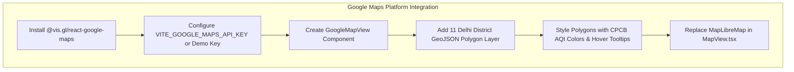

# Aerify AI — Master Status & Action Plan (CHANGES.md)

**Document Status:** Final Milestone — Google Maps Platform Integration  
**Target:** Google Hackathon Polish & Final Integration.

---

## 1. System Implementation Status Overview

All core architecture, civic UI, and municipal operations features have been implemented and verified in the codebase. The **only remaining task** is replacing the current SVG/MapLibre map with **Google Maps Platform**.

### Implementation Verification Matrix

| Area / Feature | Status | Details | Target Component |
| :--- | :---: | :--- | :--- |
| **Near You Initial State** | `[x] Done` | Displays "Allow Location to View Local AQI" invitation; does not auto-fetch Connaught Place. | `NearYouCard.tsx` |
| **Live Portal Clock** | `[x] Done` | Real-time ticking Indian Standard Time (IST) clock: `🟢 Live Portal Feed • IST`. | `ClockWidget.tsx`, `Sidebar.tsx` |
| **Officer Auth Modal** | `[x] Done` | Clean citizen-safe "Municipal Officer Sign In"; all mentions of Cloud SQL, Firebase Auth, and RBAC removed. | `OfficerAuthModal.tsx` |
| **Gemini AI Summary** | `[x] Done` | 3 clean, human-friendly bullet points; internal database IDs (`seg_cell_...`) purged. | `AgentNarrativeCard.tsx` |
| **Navigation Menu Order** | `[x] Done` | 1. Dashboard, 2. Govt Actions & Impact, 3. Action Simulations, 4. Municipal Action Center. | `Sidebar.tsx` |
| **Govt Actions & Directives** | `[x] Done` | Directives + before/after AQI drop unified into clean cards (active measures on top). | `GovernmentActionsRegistry.tsx` |
| **Multi-Area Impact Explorer** | `[x] Done` | Locality filter (Anand Vihar, Rohini, Wazirpur, Okhla, etc.) with clean Before vs. After bars. | `AreaImpactExplorer.tsx` |
| **Municipal Action Center** | `[x] Done` | Two-tab operations layout (Active Operations with `[Mark as Done]` + Priority Suggestions). | `OfficerActionsView.tsx` |
| **AQI Priority Suggestions** | `[x] Done` | Suggestions ranked by AQI severity with interactive checkboxes & dynamic combined impact calculator. | `OfficerActionsView.tsx` |
| **Action Plan Right Drawer** | `[x] Done` | Create customized action plan from selected suggestions or blank form; dispatch or schedule. | `OfficerActionsView.tsx` |
| **Global Jargon Purge** | `[x] Done` | Removed "Phase P4", "Rule 4", "Diff-in-Diff", "12 Case Catalog", and other internal terms. | Global UI |
| **Google Maps Platform** | `[ ] In Progress` | **Remaining Task:** Integrate `@vis.gl/react-google-maps` with 11 Delhi district GeoJSON overlay. | `GoogleMapView.tsx`, `MapView.tsx` |

---

## 2. Active Milestone: Google Maps Platform Integration



### Why Google Maps Platform for this Hackathon?
1. **Google Ecosystem Alignment:** Fully aligns with Vertex AI (Gemini 2.5), Firebase, Cloud Run, and Cloud SQL for maximum hackathon scoring.
2. **Generous Free Tier ($200 Monthly Credit):** Google Cloud gives $200 free credit monthly (~28,500 dynamic map loads for free).
3. **Zero-Setup Maps Demo Key:** Instant prototyping without a credit card via:  
   👉 `https://mapsplatform.google.com/maps-demo-key`

---

### Step-by-Step Execution Plan

#### Step 1: Install `@vis.gl/react-google-maps`
```bash
cd ui-bundle
npm install @vis.gl/react-google-maps
```
*(Peer dependency verified: fully compatible with React 19).*

#### Step 2: Environment Variable
In `ui-bundle/.env`:
```env
VITE_GOOGLE_MAPS_API_KEY="YOUR_API_KEY_OR_DEMO_KEY"
```
*(If unset, gracefully fall back to the public Google Maps demo key).*

#### Step 3: Implement `ui-bundle/src/components/map/GoogleMapView.tsx`
- **Container:** `<APIProvider apiKey={apiKey}>`
- **Map:** `<Map defaultCenter={{ lat: 28.6139, lng: 77.2090 }} defaultZoom={10.5}>`
- **Basemap Features:** Real Delhi roads, Yamuna River, satellite view toggle, terrain, and NCR borders (Gurugram, Noida, Ghaziabad).
- **GeoJSON District Layer:**
  ```tsx
  map.data.addGeoJson(districtsGeoJson);
  map.data.setStyle((feature) => {
    const districtId = feature.getId();
    const agg = aggregates[districtId];
    return {
      fillColor: getDistrictColor(agg?.category),
      fillOpacity: selectedDistrictId === districtId ? 0.85 : 0.65,
      strokeColor: '#0f172a',
      strokeWeight: 1.5
    };
  });
  ```
- **Interactions:**
  - `mouseover`: Display `MapTooltip` with current district AQI, primary pollutant, and weather.
  - `click`: Call `onSelectDistrict(districtId)` to open the district detail panel.

#### Step 4: Wire into `ui-bundle/src/views/MapView.tsx`
Replace `MapLibreMap` with `GoogleMapView`:
```tsx
<GoogleMapView
  districtsGeoJson={districtsGeoJson}
  aggregates={aggregates}
  activeLegend={activeLegend}
  clock={clock}
  selectedDistrictId={activeDistrictId}
  onSelectDistrict={(id) => onSelectDistrict(id)}
  onOpenContextDrawer={(id) => handleOpenDrawer(id)}
/>
```

#### Step 5: Verification Commands
```bash
cd ui-bundle
npm run build
python ../architecture/contracts/tools/validate_contracts.py
```
