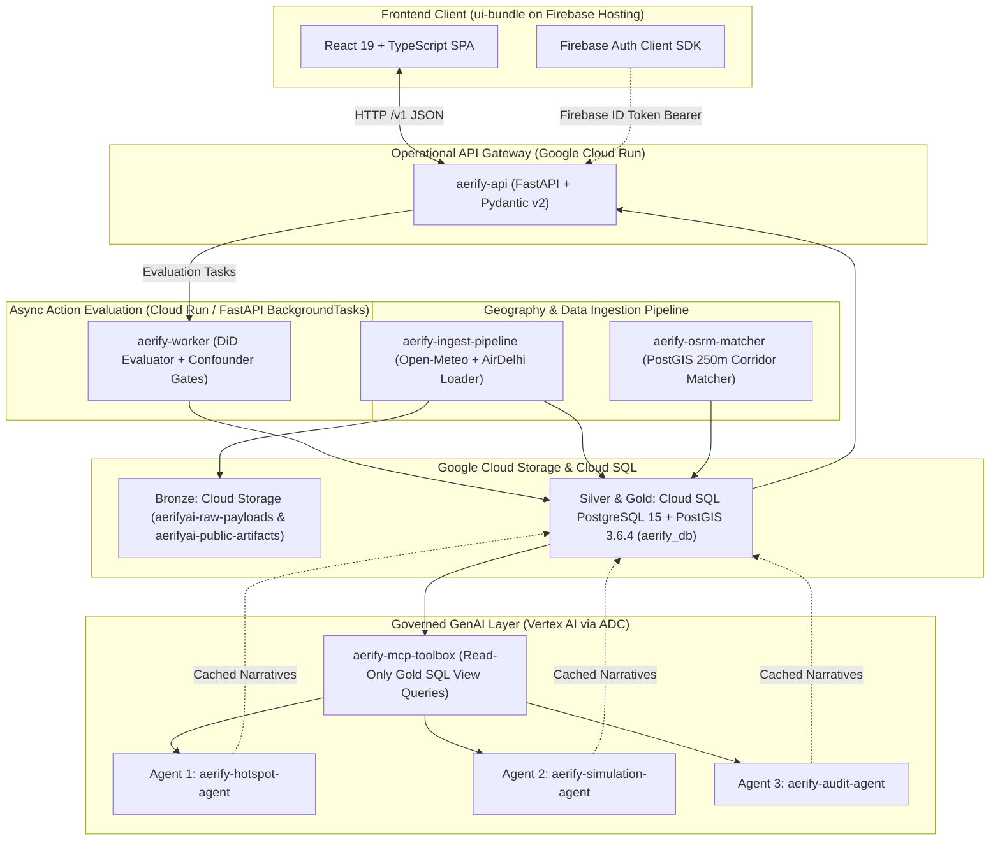

# Aerify AI — Master Leftover Tasks, Services & UI Integration Roadmap

> **Document Status:** Authoritative System Blueprint & Execution Checklist (Implemented & Verified)  
> **Architecture Revision:** `0.10` | **Schema Version:** `0.9` — Updated **17 October 2026**  
> **Scope:** Full-stack integration connecting `ui-bundle` with Google Cloud Run, Cloud SQL PostGIS (`aerifyai:asia-south1:aerify-postgis-db`), Vertex AI Gemini (`gemini-2.5-flash-lite`), and external data feeds.

---

## 1. System Architecture Overview (The 6 Core Backend Services)

Aerify AI uses a **hybrid evidence architecture** for Delhi NCT. The backend is partitioned into **6 modular services / modules**:

### The 6 Backend Services Summary:
1. **`aerify-api` (FastAPI Gateway — `backend/service/main.py`):** Implements all `/v1/public/*`, `/v1/officer/*`, `/v1/me`, and `/v1/clock` endpoints. Verifies Firebase tokens and resolves roles from Cloud SQL `app_users`.
2. **`aerify-worker` (Action Impact Evaluator — `backend/service/evaluator.py`):** Executes difference-in-differences checkpoints (+0h, +1h, +3h, +6h, +12h), block bootstrap 95% confidence intervals, detects weather confounders (`water_suppression_demo_policy_v1`), and recomputes on supervisor corrections.
3. **`aerify-ingest-pipeline` (Data Ingestion Pipeline — `backend/service/ingestion.py`):** Pulls Open-Meteo weather and air-quality models, archives raw JSON to `gs://aerifyai-raw-payloads`, and loads IIT Delhi AirDelhi bus samples.
4. **`aerify-osrm-matcher` (Road Segment Matcher — `backend/service/osrm_matcher.py`):** Snaps bus GPS traces to directed $\le 250\text{ m}$ road segments (`osrm_match_v1`, confidence $\ge 0.50$, distance $\le 40\text{ m}$).
5. **`aerify-scenario-generator` (Deterministic Scenario Engine & Artifact Exporter — `backend/service/seed_generator.py` & `export_artifacts.py`):** Generates the 11 Delhi revenue districts, 12 action zones, 1 reference zone, 3 CPCB legends, and catalog cases $S01\text{--}S12$ with paired `WITH_ACTION` and `WITHOUT_ACTION` branches, and exports static GeoJSON bundles with SHA-256 manifest to `gs://aerifyai-public-artifacts/v1/`.
6. **`aerify-mcp-toolbox` & Vertex AI Agents (`backend/agents/mcp_tools.py` & `narrative_agents.py`):** Governed read-only Gold SQL view tool layer (`v_hotspot_evidence`, `v_map_coverage`, `v_location_context`, `v_scenario_lineage`, `v_evaluation_results`) feeding 3 specialized `gemini-2.5-flash-lite` agents via Vertex AI Application Default Credentials (ADC).

---

## 2. Changes Completed in the UI (`ui-bundle`) for End-to-End Consistency

### A. Canonical Schema `0.9` Naming Alignment Across Backend & UI
- [x] **Unified `LegendBand` Keys:** Both backend and UI strictly use `band.id`, `band.label`, `band.severity_rank`, `band.lower_bound`, and `band.upper_bound` (eliminating duplicate `band_id`/`min`/`max` aliases).
- [x] **Unified `NearbySummary` Keys:** Both backend and UI strictly use `requested_position`, `nearest_road_observation`, `nearest_station`, `regional_model`, and `nearby_cities`.
- [x] **Unified `INDIAN_AQI` Metric:** `ServerLegend.tsx`, `MapView.tsx`, and `legend-bands.v1.json` use canonical `INDIAN_AQI`, `PM2_5_MASS`, and `PM10_MASS`.

### B. Environment Configuration, Proxy & Client Switching
- [x] **Vite `/v1` Proxy & `HttpApi` Integration:** `vite.config.ts` proxies `/v1` to `http://127.0.0.1:8080`, and `HttpApi.ts` supports all public, officer, and narrative endpoints (`getNarrative(agentType, targetId)`).

### C. Live Dynamic AI Narrative Integration
- [x] **Display Cached Narratives (`AgentNarrativeCard.tsx`):** Rendered in `EnvironmentalContextDrawer.tsx` (`hotspot` agent), `ScenariosView.tsx` (`simulation` agent), and `ObservedEvaluationsView.tsx` (`audit` agent) with `gemini-2.5-flash-lite` model badge, evidence bullets, confounder disclosure, and governance caveat.
- [x] **Deterministic Fallback UI State:** Gracefully displays deterministic scientific summaries when the daily Vertex AI call ceiling is reached.

---

## 3. Master Checklist Status

### Phase 1: Database & Cloud Infrastructure Setup (Completed)
- [x] **GCP Project & IAM Provisioning (`aerifyai`, `asia-south1`):**
  - [x] Enabled APIs: `sqladmin.googleapis.com`, `run.googleapis.com`, `aiplatform.googleapis.com`, `cloudtasks.googleapis.com`, `storage.googleapis.com`, `cloudbuild.googleapis.com`, `artifactregistry.googleapis.com`.
  - [x] Created service accounts: `aerify-api-sa`, `aerify-worker-sa`, `aerify-mcp-sa` with least-privilege IAM bindings.
- [x] **Cloud SQL PostgreSQL 15 + PostGIS 3.6.4:**
  - [x] Provisioned low-cost Cloud SQL instance `aerifyai:asia-south1:aerify-postgis-db` (`db-f1-micro`, 10GB SSD, `cloudsql.iam_authentication=on`).
  - [x] Created unified database `aerify_db` with `postgis` extension enabled and IAM database users granted privileges.
- [x] **Cloud Storage Buckets (`asia-south1`):**
  - [x] Created `gs://aerifyai-raw-payloads` (immutable Bronze storage).
  - [x] Created `gs://aerifyai-public-artifacts` (public GeoJSON bundles + SHA-256 `manifest.json`).
  - [x] Created `gs://aerifyai-media-restricted` (officer contextual media metadata).

### Phase 2: Backend Services Implementation (`backend/` — Completed)
- [x] **Core Setup & Database Schema (`backend/service/models.py`, `gold_views.py`):**
  - [x] Created all Silver/Gold tables and 6 governed Gold SQL views (`v_map_aggregates`, `v_map_coverage`, `v_hotspot_evidence`, `v_location_context`, `v_scenario_lineage`, `v_evaluation_results`).
  - [x] Seeded live Cloud SQL `aerify_db` (`11 districts`, `13 zones`, `12 scenarios S01–S12`, `3 CPCB legends`).
  - [x] Exported `v1/districts.geojson`, `v1/analysis_cells.geojson`, `v1/measured_roads.geojson`, and `v1/manifest.json` to `gs://aerifyai-public-artifacts/v1/`.
- [x] **Services 1–6 & Vertex AI Gemini Agents:**
  - [x] Implemented `aerify-api` (`backend/service/main.py`), `aerify-worker` (`backend/service/evaluator.py`), `aerify-ingest-pipeline` (`backend/service/ingestion.py`), `aerify-osrm-matcher` (`backend/service/osrm_matcher.py`), and `aerify-mcp-toolbox` + 3 Vertex AI agents (`backend/agents/mcp_tools.py`, `backend/agents/narrative_agents.py`).

### Phase 3 & Phase 4: Verification, Contract Gates & Build Readiness (Completed)
- [x] Official contract verification gate: `python architecture/contracts/tools/validate_contracts.py` $\rightarrow$ `OK: schema 0.9; 10 fixtures, 3 legends, 12 catalog cases validated`.
- [x] Backend live integration & contract test suite: `pytest backend/tests/test_api_and_contracts.py` $\rightarrow$ `8 passed` against live Cloud SQL PostGIS and live Vertex AI `gemini-2.5-flash-lite`.
- [x] Frontend TypeScript & Vite production build gate: `npx tsc --noEmit && npm run build` in `ui-bundle` $\rightarrow$ `0 errors`.
